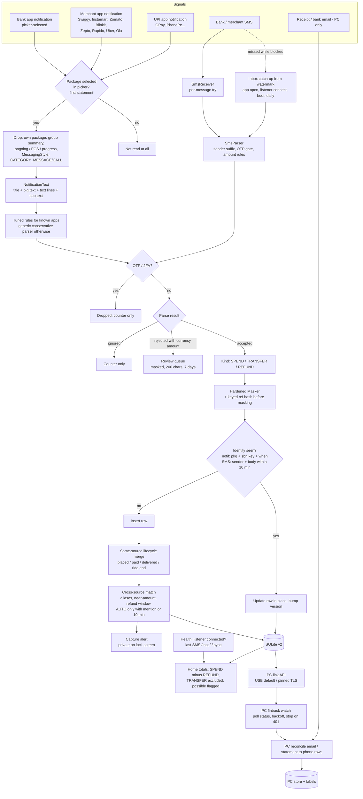

# 00 — Target capture pipeline (overview)

Planning document. Nothing here is implemented yet. Each use-case flow (01–08) and each draft issue (`docs/issues/NNN-*.md`) refers back to this page.

**Finding ids** cite the research reports: `R1M-Fn` (capture audit for SMS + the 7 merchant apps), `R1B-Fn` (broad capture audit), `R2-Fn` (sync and alerts), `R3M` / `R3B` (payments research: merchant-focused / broad; cited by section), `R4-Sn` (security findings) and `R4-Rn` (security requirements for the planned features). Paths are under `android/app/src/main/java/com/fintrack/` unless they start with `pc/`.

## Pipeline

## Glossary

| Term | Meaning |
|---|---|
| **Signal** | One message that says money moved: a bank SMS, a merchant SMS, a UPI-app notification, a merchant-app notification, a bank-app notification, or (PC only) an email or statement line. One real payment usually produces 1–4 signals. |
| **Source type** | Where a signal came from. It decides how much the signal is trusted and which record becomes the main one. Today: `BANK`, `DELIVERY` (merchant SMS), `UPI_APP`, `MERCHANT_APP` (core/Models.kt:9). Planned: `BANK_APP` for picker-selected bank apps. PC-only: `EMAIL`, `STATEMENT`. Main-record rank: BANK 0, BANK_APP 1, UPI_APP 2, MERCHANT_APP 3, DELIVERY 4. |
| **App type (picker)** | What the user sets for each selected app: Bank / UPI / Merchant. It maps to the source type. |
| **Kind** | What the money movement means for spending. `SPEND` counts. `REFUND` nets off spend. `TRANSFER` (wallet top-up, card bill payment, UPI Lite load) never counts. Planned column (issue 002). |
| **Identity key** | What makes two captures "the same message". For a notification it is `package + sbn.key + when`: an update to that notification replaces the row instead of adding one. For an SMS it is `sender key + masked body`, with sent times within ±10 min (this covers receiver vs inbox-import time skew). A keyed hash of the raw reference number keeps two genuine ₹20 payments apart after masking. |
| **Lifecycle merge** | Linking several signals from the **same** source about one order or ride, such as Swiggy "order placed ₹349" → "you paid ₹349" → "delivered", or Rapido "Pay ₹103" → "payment of ₹103 received". The result is one counted record. |
| **Auto link** | A duplicate link the phone is confident about. The duplicate is left out of totals. It requires a merchant mention (brand, legal name or alias) or a gap of ≤10 min, and an exact or near amount. |
| **Possible link** | A plausible but uncertain duplicate. It **still counts** until the user confirms it, and it is flagged in the UI. Used for near amounts, long gaps, a driver's personal UPI ID, and refunds that arrive days later. |
| **Transfer** | Money that moves between your own stores of value: bank → Swiggy Money / Ola Money / Uber Cash / Rapido Wallet / UPI Lite, or bank → credit card bill. It is recorded but never counted as spend. Spend from the wallet is counted when it happens. |
| **Review queue** | A short-lived masked list of texts that were rejected but had a currency amount. The user can "Add as payment" or "Ignore". It is never synced. |
| **Watermark** | The newest SMS timestamp already processed. Inbox catch-up rescans from `watermark − 1 day`. |

## Use cases

| # | Flow | Main issues |
|---|---|---|
| 01 | [SMS capture](01-sms-capture.md) | 005, 007, 008, 010 |
| 02 | [Food / quick-commerce order](02-food-quick-commerce-order.md) | 004, 006, 009, 011, 012 |
| 03 | [Ride payment](03-ride-payment.md) | 006, 011, 013 |
| 04 | [Refunds, reversals, wallet top-ups](04-refunds-reversals-wallet-topups.md) | 012, 014 |
| 05 | [App picker setup](05-app-picker-setup.md) | 015, 016, 017, 018, 019 |
| 06 | [Capture alert and categorize](06-capture-alert-and-categorize.md) | 021, 022, 029 |
| 07 | [Recovery and health](07-recovery-and-health.md) | 008, 023, 024, 025, 030 |
| 08 | [Auto sync](08-auto-sync.md) | 026, 027, 028, 032, 033, 034 |

Out of scope by decision: Account Aggregator (needs an RBI/SEBI-regulated FIU and Sahamati certification, and allows only periodic fetches, R3B §Fetch alternatives), screen reading through an accessibility service (rejected: Play policy, and it would see UPI PIN / OTP screens), and auto-suggesting apps (the text of apps you have not selected is never read).
